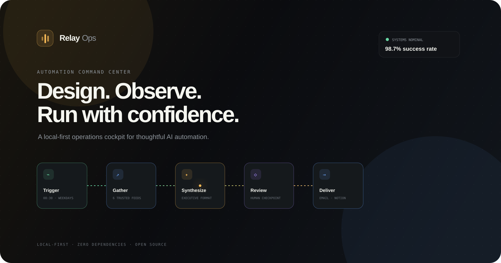
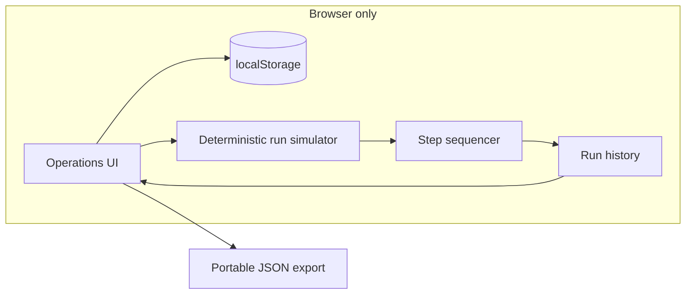

<div align="center">
  

  <br />

**A calm, local-first command center for designing and simulating AI automations.**

[](#quick-start)
[](app.js)
[](#privacy-by-design)
[](LICENSE)
</div>

## Why Relay Ops?

Automation builders are good at showing **what you configured**. They are often much worse at showing **what is happening**.

Relay Ops explores a more operational interface: one place to scan every automation, understand its live blueprint, simulate a run step by step, inspect history, and export a portable definition. It is designed like a production cockpit—not a collection of disconnected settings pages.

> This repository is an interactive product prototype. Runs, metrics, and integrations are intentionally simulated in the browser; it does not call an LLM or third-party service.

## Product highlights

- **Blueprint view** — see trigger, intelligence, review, and action steps as one readable execution path.
- **Animated run simulation** — run any flow and watch execution travel through each stage.
- **Operational signals** — success rate, runtime, volume, schedules, and recent runs stay close to the workflow.
- **Create and persist** — scaffold a new automation and keep changes in `localStorage`.
- **Portable export** — download the current workflow as human-readable `.relay.json`.
- **Command palette** — press <kbd>⌘</kbd>/<kbd>Ctrl</kbd> + <kbd>K</kbd>; keyboard shortcuts cover the common path.
- **Responsive and accessible** — usable from a wide desktop down to a narrow mobile viewport, with focus states and reduced-motion support.
- **Zero dependency runtime** — no framework, package install, API key, account, or build pipeline.

## Architecture



The project keeps state and rendering intentionally direct:

```text
index.html           semantic product shell and dialogs
styles.css           design system, responsive layout, motion
app.js               state, rendering, simulation, persistence
assets/cover.svg      repository artwork
```

## Quick start

No installation is required.

```bash
git clone https://github.com/harshareddy0405/relay-ops.git
cd relay-ops
python3 -m http.server 8080
```

Open [http://localhost:8080](http://localhost:8080). You can also open `index.html` directly; a local server simply gives the browser a more realistic origin.

## Take the product tour

1. Pick a workflow from the left rail and inspect how its execution blueprint changes.
2. Select **Run now** (or press <kbd>R</kbd>) to watch a deterministic local simulation.
3. Use the status toggle to pause or activate its schedule.
4. Press <kbd>⌘</kbd>/<kbd>Ctrl</kbd> + <kbd>K</kbd> to open the command palette.
5. Create an automation with the **+** button; refresh the page to see persistence.
6. Export a blueprint and inspect the generated JSON.

Keyboard shortcuts:

| Shortcut                                    | Action                  |
| ------------------------------------------- | ----------------------- |
| <kbd>⌘</kbd>/<kbd>Ctrl</kbd> + <kbd>K</kbd> | Open commands           |
| <kbd>/</kbd>                                | Focus automation search |
| <kbd>R</kbd>                                | Run selected automation |
| <kbd>N</kbd>                                | Create an automation    |

## Design decisions

- **Information before decoration.** Dense operational detail is organized with strong type, spacing, and contrast—not hidden behind extra clicks.
- **Honest simulation.** Every synthetic value is presented as demo data, and the UI never implies a live model or integration.
- **Progressive energy.** The interface stays quiet at rest; color and motion become prominent only during an active run.
- **Portable by default.** Workflow definitions are plain JSON rather than a proprietary opaque format.

## Privacy by design

Relay Ops runs entirely in your browser. The demo makes no network requests for automation data, sends no telemetry, and needs no credentials. Custom workflows and simulated run history are stored only in browser `localStorage`. Use **Clear simulation** or clear the site’s storage to remove them.

Google Fonts are loaded for the visual presentation. If you need a fully offline deployment, replace the two font-family declarations with system fonts or self-host the files.

## Roadmap

- [ ] Drag-to-reorder workflow steps
- [ ] Import and validate `.relay.json` blueprints
- [ ] Branching, retries, and human-approval nodes
- [ ] Deterministic failure injection and replay
- [ ] Pluggable provider adapters behind a permission boundary
- [ ] Shareable read-only workflow snapshots

## Contributing

Ideas, accessibility fixes, and interface experiments are welcome.

1. Fork the repository and create a focused branch.
2. Keep the zero-build, local-first baseline intact.
3. Test keyboard use and both desktop and mobile layouts.
4. Open a pull request with a short before/after description.

## License

[MIT](LICENSE) © 2026 Harshavardhan

---

<div align="center">
  Built as an exploration of humane, observable AI automation interfaces.
</div>

## Built to be inspected

[](https://github.com/harshareddy0405/relay-ops/actions/workflows/ci.yml)

The project includes versioned source, guarded local persistence, malformed-data recovery, product-specific interaction tests, and automated accessibility semantics checks. No API key is required to explore it.

```bash
# Optional development checks; the app itself needs no installation
npm ci --ignore-scripts
npm run check
npm test
npm run format:check
```

[Engineering notes](docs/ENGINEERING.md) · [Contributing](CONTRIBUTING.md) · [Security & privacy](SECURITY.md)

**Scope:** No real scheduler or service connector runs. Blueprint dates use Asia/Kolkata; seeded dashboard metrics are illustrative, while reports use locally recorded runs.
